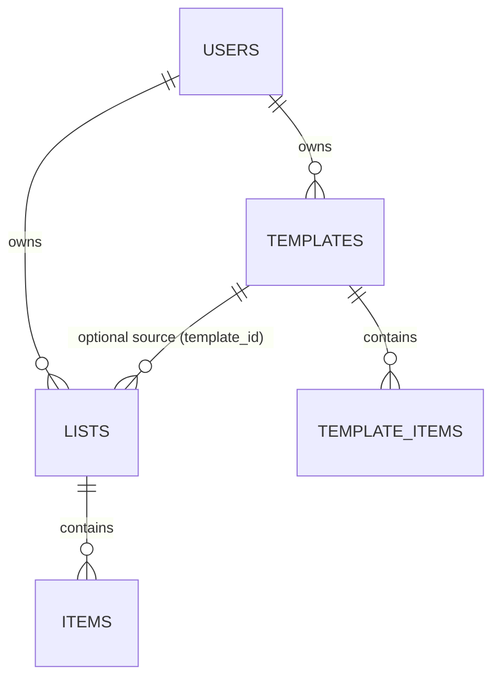

# Data Schema

This service stores data in MongoDB with these collections:

- `users`
- `lists`
- `items`
- `templates`
- `template_items`
- `groups`
- `grouping_runs`
- `unmatched_items`

All API responses serialize Mongo `_id` to a string field named `id`.

## Entity Relationship Diagram

Notes:

- `LISTS.template_id` is optional (`null` when a list is created manually).
- Creating a list from a template copies `TEMPLATE_ITEMS` into new `ITEMS`.

## Conventions

- Timestamps use UTC-aware datetimes (`created_at`, `updated_at`, etc.).
- Ownership is enforced with `user_id` filters on all list/item/template queries.
- Reference fields (`user_id`, `list_id`, `template_id`) are stored as strings, not `ObjectId`.
- Text validation (API layer):
  - `name`: `1..200` characters

## Collection: `users`

Created/updated during Google ID token auth.
New users are created on hold and must be manually approved.

Fields:

- `_id`: `ObjectId` (serialized as `id`)
- `google_sub`: `string` (unique index)
- `approved`: `bool` (new users default to `false`)
- `admin`: `bool` (new users default to `false`; changed only via ops tasks)
- `email`: `string | null`
- `name`: `string | null`
- `avatar_url`: `string | null`
- `created_at`: `datetime` (set on first login)
- `last_login_at`: `datetime` (updated on each login)

Indexes:

- `google_sub` unique

## Collection: `lists`

Fields:

- `_id`: `ObjectId` (serialized as `id`)
- `user_id`: `string` (owner user id)
- `name`: `string` (required)
- `template_id`: `string | null` (source template if created from one)
- `created_at`: `datetime`
- `updated_at`: `datetime`

Indexes:

- compound: `(user_id ASC, updated_at DESC)`

## Collection: `items`

Represents checklist entries inside a list.

Fields:

- `_id`: `ObjectId` (serialized as `id`)
- `user_id`: `string` (owner user id)
- `list_id`: `string` (parent list id)
- `name`: `string` (required)
- `qty`: `number | null`
- `purchased`: `bool` (default `false`)
- `purchased_at`: `datetime | null` (set when purchased)
- `sort_order`: `int` (default `0`)
- `group_id`: `string | null` (absent until grouped; `null` means "Other"; never returned by the API)
- `created_at`: `datetime`
- `updated_at`: `datetime`

Indexes:

- compound: `(user_id ASC, list_id ASC)`
- compound: `(list_id ASC, sort_order ASC)`

## Collection: `templates`

Reusable shopping-list blueprints.

Fields:

- `_id`: `ObjectId` (serialized as `id`)
- `user_id`: `string` (owner user id)
- `name`: `string` (required)
- `created_at`: `datetime`
- `updated_at`: `datetime`

Indexes:

- compound: `(user_id ASC, updated_at DESC)`

## Collection: `template_items`

Line items for a template.

Fields:

- `_id`: `ObjectId` (serialized as `id`)
- `user_id`: `string` (owner user id)
- `template_id`: `string` (parent template id)
- `name`: `string` (required)
- `qty`: `number | null`
- `sort_order`: `int` (default `0`)
- `group_id`: `string | null` (as on `items`; copied when a list is created from the template)
- `created_at`: `datetime`
- `updated_at`: `datetime`

Indexes:

- compound: `(user_id ASC, template_id ASC)`
- compound: `(template_id ASC, sort_order ASC)`

## Collection: `groups`

Admin-managed product groups used by "Group by kind", in shopping order.
The built-in "Other" group is never stored; the API appends it last.

Fields:

- `_id`: `ObjectId` (serialized as `id`)
- `name`: `string` (1..60 characters, whitespace collapsed)
- `name_key`: `string` (case-folded `name`; unique; "other" is reserved)
- `position`: `int` (order; new groups take the highest position + 1)
- `created_at`: `datetime`
- `updated_at`: `datetime`

Indexes:

- unique: `name_key ASC`
- single: `position ASC`

Seeded once per environment with `python -m app.tasks seed-default-groups`.

## Collection: `grouping_runs`

One per grouping tap that left items in "Other"; lets the shopper send those
names to admins without the browser supplying them.

Fields:

- `_id`: `ObjectId` (serialized as `run_id`)
- `user_id`: `string` (owner user id)
- `target_kind`: `"list" | "template"`
- `target_id`: `string`
- `unmatched`: `[{item_id: string, name: string}]` (names as the model judged them)
- `created_at`: `datetime`
- `sent_at`: `datetime | null`

Indexes:

- TTL: `created_at ASC`, expires after 1 hour

## Collection: `unmatched_items`

Item names shoppers chose to share because they fit no group, for admins to
review. Holds names only: no user, list or template reference.

Fields:

- `_id`: `ObjectId` (serialized as `id`)
- `name`: `string` (cleaned of control characters and line breaks; latest spelling sent)
- `name_key`: `string` (case-folded, whitespace collapsed)
- `count`: `int` (number of sends that included this name while open)
- `last_sent_at`: `datetime`
- `created_at`: `datetime`
- `resolved_at`: `datetime | null` (set when an admin creates a group from it or dismisses it)
- `resolution`: `"group_created" | "dismissed" | null`

Indexes:

- unique partial: `name_key ASC` where `resolved_at` is null (one open entry per name)
- compound: `(resolved_at ASC, last_sent_at DESC)`

A name sent again after it was resolved opens a new entry; resolved entries are kept.

## Relationships and Lifecycle

- `users (1) -> (N) lists`
- `lists (1) -> (N) items`
- `users (1) -> (N) templates`
- `templates (1) -> (N) template_items`

Application-level cascades:

- Deleting a `list` also deletes its `items`.
- Deleting a `template` also deletes its `template_items`.
- Creating a list from a template copies all `template_items` into new `items` for the new list.
